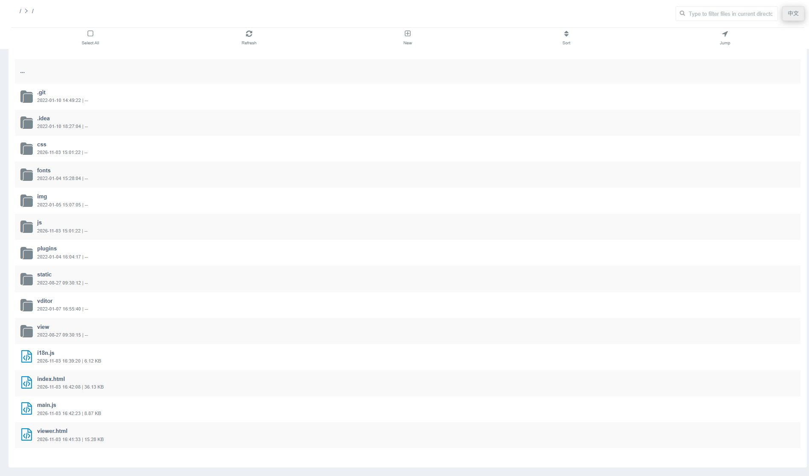
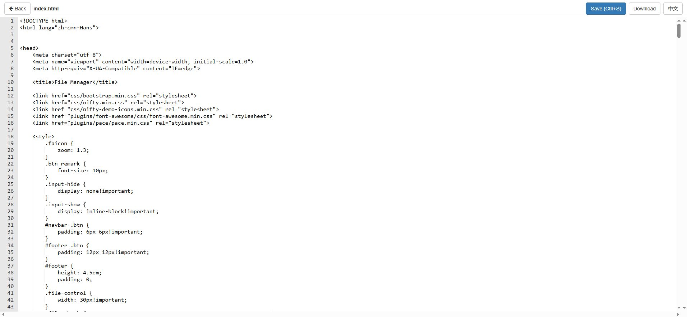
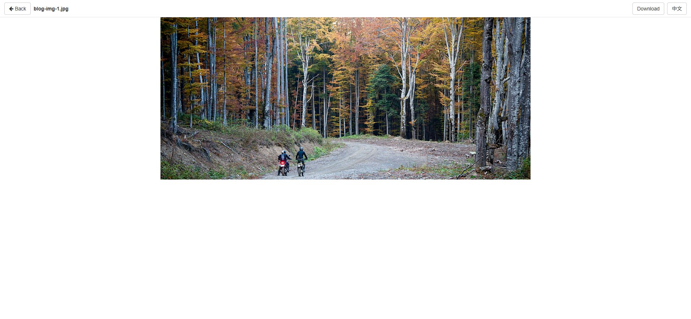

# WebDAV File Manager

A zero-build, pure-static WebDAV web client — copy the files into any WebDAV-served directory and it just works. No Node, no bundler, no server-side code.



## Features

- **File management**: browse, create folder/file, upload (multi-file & entire folders, drag & drop), download, copy/cut/paste, rename, delete — with overwrite/skip conflict handling
- **Unified previewer** ([viewer.html](viewer.html)): one page for
  - Images (zoom/rotate via [Viewer.js](https://github.com/fengyuanchen/viewerjs))
  - Video ([xgplayer](https://github.com/bytedance/xgplayer))
  - Audio, PDF (native rendering)
  - Text/code with syntax highlighting ([ACE](https://ace.c9.io), modes for JS/HTML/CSS/Python/Java/Go/PHP/SQL/XML/YAML/...)
  - Markdown editing ([Vditor](https://github.com/Vanessa219/vditor))
  - `_davshell.sh` / `_davshell.cmd` — edit a shell script and run it on the server companion with live output (`_davshell.out`)
- **Root auto-discovery**: if no `?root=` is given, the page probes its own directory, then walks up level by level until a WebDAV endpoint responds
- **i18n**: English / 简体中文, auto-detected from the browser, switchable anytime via the header button, persisted in `localStorage`
- **Read-only share mode**: append `?readonly` to the URL to hide all write operations
- **Nice touches**: natural sort (file2 < file10), in-directory keyword filter, per-type file icons with image thumbnails, hidden (dot) files, keyboard shortcuts (`Ctrl+A` select, `Delete` delete, `F2` rename, `Esc` cancel, `Ctrl+S` save in viewer), mobile layout with long-press multi-select, XSS-escaped file names





## Getting Started

1. Serve the `index.html`, `viewer.html` and the asset folders (`css/`, `js/`, `img/`, `plugins/`, `vditor/`, `fonts/`, `static/`) from the **same WebDAV root** you want to manage (any static-capable WebDAV server works, e.g. [hacdias/webdav](https://github.com/hacdias/webdav)).
2. Open `index.html`. Authentication uses the browser's native WebDAV login (Basic/Digest).
3. Optional URL parameters:
   - `?root=<url>` — explicit WebDAV root, skips auto-discovery
   - `?readonly` — read-only mode

## Project Layout

```
index.html          file manager page
viewer.html         unified preview / edit page
js/webdav.js        raw WebDAV client (namespaces-agnostic PROPFIND parsing)
js/main.js          file manager logic (discovery, upload queue, shortcuts)
js/i18n.js          zh-CN / en dictionary + t() helper
js/mode-*.js        ACE syntax modes
screenshots/        English UI screenshots
```

## Compatibility

Modern Chrome / Edge / Firefox / Safari (desktop & mobile). All dependencies are vendored — no network access needed at runtime beyond the WebDAV server itself.
